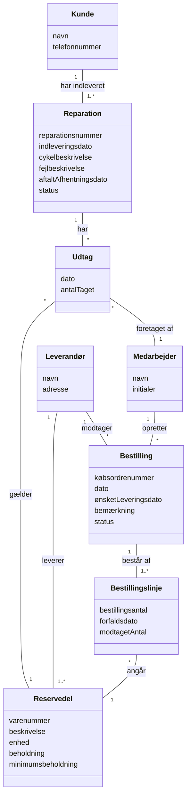

# Domænemodel – Vekto Cykelværksted

Domænemodellen viser de begreber i Vektos forretning, som systemet skal kende, deres egenskaber og relationer. Den er udarbejdet i Google Docs og er her skrevet om til Mermaid, så den kan versionsstyres sammen med resten af dokumentationen. Begreberne er forklaret i [ordlisten](../0.%20Ordliste/ordliste.md).

## Diagram

## Klasser

| Klasse | Attributter | Beskrivelse |
| :---- | :---- | :---- |
| **Reparation** | reparationsnummer, indleveringsdato, cykelbeskrivelse, fejlbeskrivelse, aftaltAfhentningsdato, status | Én indleveret cykel og det arbejde, der skal udføres på den. Kaldes *Service* i brugergrænsefladen. |
| **Kunde** | navn, telefonnummer | Den, der har indleveret cyklen. Telefonnummeret bruges som søgenøgle. |
| **Udtag** | dato, antalTaget | At en medarbejder har taget et antal af en reservedel til en reparation. |
| **Reservedel** | varenummer, beskrivelse, enhed, beholdning, minimumsbeholdning | En del, der bruges ved reparationer og ligger på lager. |
| **Medarbejder** | navn, initialer | En person ansat hos Vekto. |
| **Leverandør** | navn, adresse | Virksomhed, der leverer reservedele (fx Nordic Bike Parts A/S). |
| **Bestilling** | købsordrenummer, dato, ønsketLeveringsdato, bemærkning, status | Indkøb af reservedele hos én leverandør. |
| **Bestillingslinje** | bestillingsantal, forfaldsdato, modtagetAntal | Én reservedel og antal på en bestilling. |

## Relationer

| Fra | Til | Multiplicitet | Betydning |
| :---- | :---- | :---- | :---- |
| Kunde | Reparation | 1 – 1..\* | En kunde har indleveret mindst én reparation. En reparation tilhører én kunde. |
| Reparation | Udtag | 1 – \* | En reparation kan have mange udtag. Et udtag hører til én reparation. |
| Udtag | Reservedel | \* – 1 | Et udtag gælder én reservedel. En reservedel kan indgå i mange udtag. |
| Udtag | Medarbejder | \* – 1 | Et udtag er foretaget af én medarbejder. |
| Leverandør | Reservedel | 1 – 1..\* | En leverandør leverer mindst én reservedel. En reservedel har én leverandør. |
| Leverandør | Bestilling | 1 – \* | En bestilling sendes til én leverandør. |
| Medarbejder | Bestilling | 1 – \* | En bestilling er oprettet af én medarbejder. |
| Bestilling | Bestillingslinje | 1 – 1..\* | En bestilling har mindst én linje. |
| Bestillingslinje | Reservedel | \* – 1 | En linje angår én reservedel. |

## Sammenhæng med use cases

| Klasse | Oprettes / ændres i |
| :---- | :---- |
| Medarbejder | UC1 |
| Kunde | UC2 |
| Reparation | UC3 (oprettes med status Åben), UC5 (udført arbejde, status Lukket) |
| Udtag, Reservedel.beholdning | UC6 (udtag nedskriver beholdning) |
| Reservedel | UC8 (oprettes med navn, leverandør og minimum), UC7 (vises og vurderes mod minimum) |
| Reservedel.beholdning, Bestillingslinje.modtagetAntal | UC9 (modtagelse lægges til beholdning) |

## Åbne punkter (modellen og use casene er ikke helt ens)

Modellen blev tegnet før use casene blev skrevet færdige. Følgende skal afklares i teamet og evt. rettes i modellen:

1. **Udført arbejde (UC5):** Modellen har ingen attribut til beskrivelsen af udført arbejde på *Reparation*, og ingen relation mellem *Reparation* og den *Medarbejder*, der har udført arbejdet.
2. **Fejltype (UC3):** Fejltype vælges i en dropdown, men findes ikke som attribut på *Reparation*. Mærke og model indtastes hver for sig, mens modellen har én *cykelbeskrivelse*.
3. **Reservedelsnavn (UC8):** Use casene bruger *navn* som unikt navn på en reservedel, mens modellen har *varenummer* og *beskrivelse*. Der skal vælges, hvilken attribut der er det navn, brugeren ser og søger på.
4. **Leverandør på Reservedel:** UC8 kræver leverandør pr. reservedel. Det passer med relationen Leverandør – Reservedel.
5. **Bestilling i prototypen:** UC7 og UC9 bruger kun bestillingslisten og beholdningen. *Bestilling* og *Bestillingslinje* er i modellen, men ingen use case opretter dem endnu. Skal en bestilling gemmes (som fil, der kan printes eller sendes), kræver det en ny use case.
6. **Aftalt afhentningsdato:** Ingen use case sætter datoen.
7. **Bestillingslinjens "forfaldsdato":** Betydningen skal afklares (forventet leveringsdato?).
8. **Antal på lager ved oprettelse:** UC8 sætter beholdningen til 0 \[Antagelse\]. Startoptælling kunne kræve en anden løsning.
