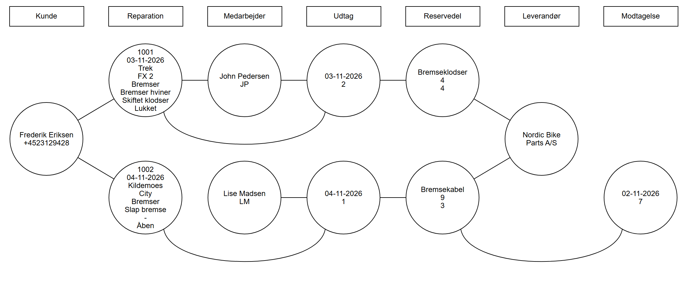

# Objektmodel – Vekto Cykelværksted

Objektmodellen er et øjebliksbillede af systemet med konkrete objekter og værdier. Den følger [domænemodellen](../2.%20Domænemodel/domænemodel.md): Hver kolonne er en klasse, hver cirkel er et objekt af klassen, og hver linje er en relation mellem to objekter.

- [objektmodel.png](objektmodel.png) – billedet af modellen.
- [objektmodel.drawio](objektmodel.drawio) – samme model, som kan redigeres i draw.io (diagrams.net).
- [objektmodel.puml](objektmodel.puml) – samme objekter i PlantUML (uden buede linjer).

## Sådan læses modellen

- Øverst står klasserne. Under hver klasse står dens objekter som cirkler.
- I cirklen står attributternes værdier i samme rækkefølge som i domænemodellen. Fx står der i en reparation: reparationsnummer, indleveringsdato, mærke, model, fejltype, fejlbeskrivelse, udførtArbejde og status.
- **-** betyder, at værdien ikke er udfyldt endnu (reparation 1002 har intet udført arbejde, fordi den stadig er åben).
- En buet linje forbinder to objekter, der ikke står i nabokolonner, fx en reparation og dens udtag.

## Situationen

Billedet viser systemet den 4. november 2026, efter at følgende er sket:

1. **John Pedersen (JP)** og **Lise Madsen (LM)** er oprettet som medarbejdere (UC1).
2. **Frederik Eriksen** er oprettet som kunde (UC2).
3. **Bremseklodser** (minimum 4) og **Bremsekabel** (minimum 3) er oprettet med leverandøren **Nordic Bike Parts A/S** (UC8).
4. 2. november: Bremsekablet står på bestillingslisten med 3 på lager. Der modtages **7 bremsekabler** (UC9), så der nu er 10.
5. 3. november: Frederik indleverer sin **Trek FX 2**, fordi bremserne hviner. Reparation **1001** oprettes med status *Åben* (UC3).
6. John tager **2 bremseklodser** til reparation 1001 (UC6). Bremseklodserne går fra 6 til 4.
7. John skriver det udførte arbejde, *Skiftet klodser*, og reparation 1001 får status *Lukket* (UC5).
8. 4. november: Frederik indleverer sin **Kildemoes City** med en slap bremse. Reparation **1002** oprettes med status *Åben* (UC3).
9. Lise tager **1 bremsekabel** til reparation 1002 (UC6). Bremsekablet går fra 10 til 9.

Bremseklodserne har nu 4 på lager og minimum 4. De står derfor på bestillingslisten i UC7. Bremsekablet har 9 på lager og minimum 3 og skal ikke bestilles.

## Hvad modellen viser

| Relation i domænemodellen | Eksempel i objektmodellen |
| :---- | :---- |
| Kunde 1 – 0..\* Reparation | Frederik har to reparationer: 1001 og 1002. |
| Reparation 0..\* – 0..1 Medarbejder | John har udført arbejdet på 1001. 1002 er åben og har endnu ingen medarbejder. |
| Reparation 1 – 0..\* Udtag | 1001 og 1002 har hver ét udtag. |
| Udtag 0..\* – 1 Medarbejder | John har lavet udtaget til 1001, Lise udtaget til 1002. |
| Udtag 0..\* – 1 Reservedel | Udtaget til 1001 er bremseklodser, udtaget til 1002 er bremsekabel. |
| Leverandør 1 – 1..\* Reservedel | Nordic Bike Parts A/S leverer begge reservedele. |
| Reservedel 1 – 0..\* Modtagelse | Bremsekablet har én modtagelse. Bremseklodserne har ingen. |
