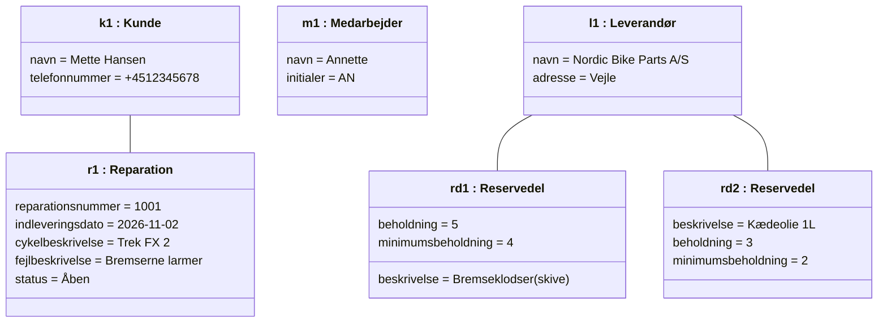
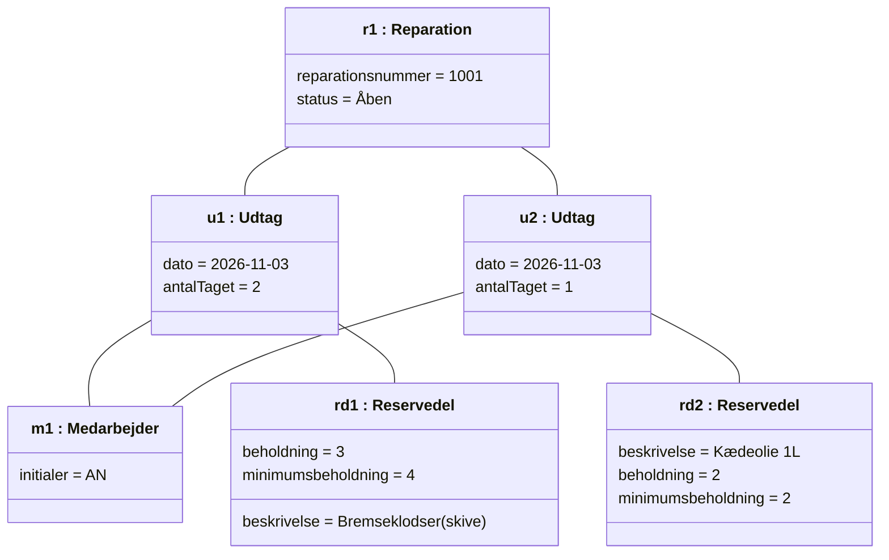

# Objektmodel – Vekto Cykelværksted

En objektmodel viser konkrete objekter og deres værdier på et bestemt tidspunkt. Den bygger på [domænemodellen](../2.%20Domænemodel/domænemodel.md) og er her vist for use case [UC6 Reservedele udtag](../1.%20Usecases/UC6%20Reservedele%20udtag.md).

Alle navne og værdier er **eksempeldata**, som vi har fundet på til at vise modellen (bortset fra reservedelsnavnene, som kommer fra lagerarket i uge 37).

## Situation

En mekaniker (Annette) har brugt 2 sæt bremseklodser og 1 liter kædeolie på reparation 1001 og registrerer udtaget (UC6).

## Før udtaget gemmes

## Efter udtaget er gemt

## Hvad ændrede sig

| Objekt | Før | Efter |
| :---- | :---- | :---- |
| u1 : Udtag | findes ikke | oprettet, knyttet til r1, m1 og rd1 (antalTaget = 2) |
| u2 : Udtag | findes ikke | oprettet, knyttet til r1, m1 og rd2 (antalTaget = 1) |
| rd1 : Reservedel | beholdning = 5 | beholdning = 3, dvs. under minimum (4), så bremseklodser kommer på bestillingslisten (UC7) |
| rd2 : Reservedel | beholdning = 3 | beholdning = 2, dvs. på minimum (2), så kædeolie også kommer på bestillingslisten (UC7) |

Eksemplet viser også reglen fra UC7: en reservedel skal bestilles, når beholdningen er **på eller under** minimum.
