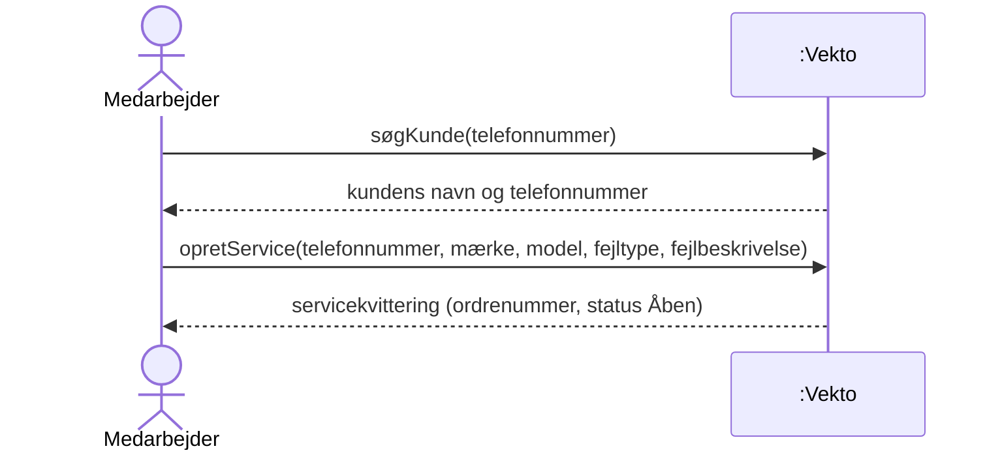
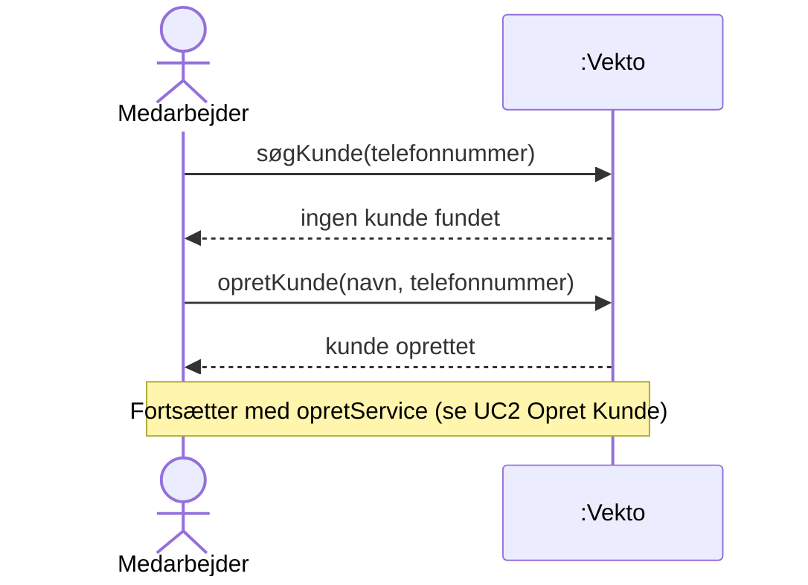
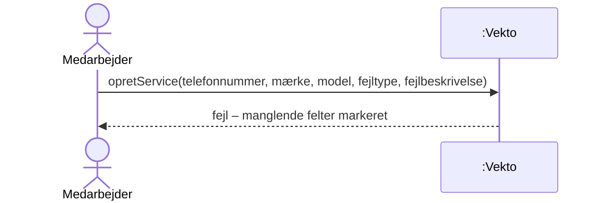

# SSD – UC3 Opret Service

Systemsekvensdiagram for [UC3 Opret Service](../1.%20Usecases/UC3%20Opret%20Service.md). Systemet er en sort boks (*Vekto*).

## Hovedscenarie

## Udvidelser

### 3a. Kunden findes ikke

### 6a. Obligatoriske felter mangler

## Systemoperationer

| Operation | Parametre | Svar | Kontrakt |
| :---- | :---- | :---- | :---- |
| søgKunde | telefonnummer | Kundens navn og telefonnummer | – (forespørgsel, ændrer intet) |
| opretKunde | navn, telefonnummer | Bekræftelse | Se UC2 |
| opretService | telefonnummer, mærke, model, fejltype, fejlbeskrivelse | Servicekvittering | [SOK](../5.%20System%20Operations%20Kontrakt/SOK%20UC3%20Opret%20Service.md) |

## Noter

- Ordrenummer, status (*Åben*) og indleveringsdato sættes af systemet og er derfor ikke parametre.
- `søgKunde` identificerer kunden på telefonnummer, som er søgenøglen i UC2. Det samme nummer bruges derefter i `opretService`. \[Antagelse\]
