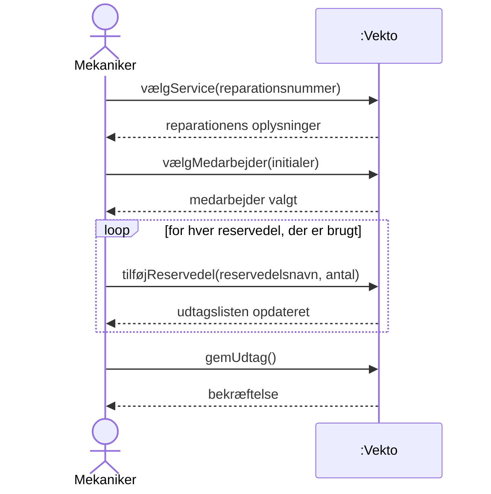
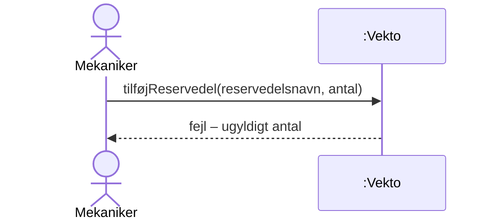
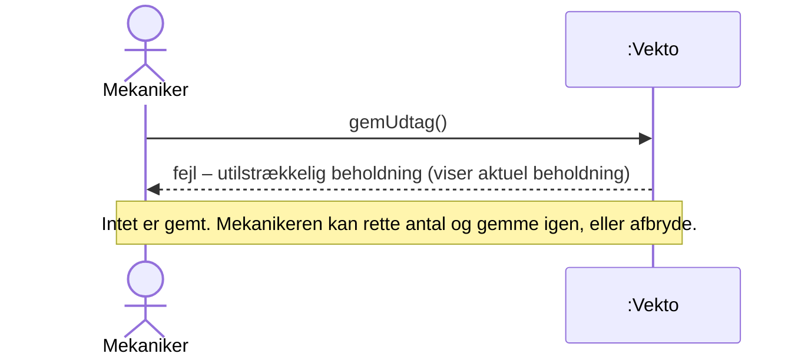

# SSD – UC6 Reservedele udtag

Systemsekvensdiagram for [UC6 Reservedele udtag](../1.%20Usecases/UC6%20Reservedele%20udtag.md). Systemet er en sort boks (*Vekto*). Diagrammet viser kun aktørens hændelser til systemet og systemets svar, ikke hvordan systemet er bygget.

## Hovedscenarie

## Udvidelser

### 3a. Antal er ikke et positivt helt tal

### 7a. Beholdningen er utilstrækkelig

## Systemoperationer

| Operation | Parametre | Svar | Kontrakt |
| :---- | :---- | :---- | :---- |
| vælgService | reparationsnummer | Reparationens oplysninger | – |
| vælgMedarbejder | initialer | Bekræftelse på valgt medarbejder | – |
| tilføjReservedel | reservedelsnavn, antal | Opdateret udtagsliste | [SOK](../5.%20System%20Operations%20Kontrakt/SOK%20UC6%20Reservedele%20udtag.md) |
| gemUdtag | – | Bekræftelse eller fejl | [SOK](../5.%20System%20Operations%20Kontrakt/SOK%20UC6%20Reservedele%20udtag.md) |

## Noter

- Valg af service og medarbejder sker i skærmbilledet via dropdown eller søgning (UC6 trin 2). De er vist som to operationer, men kan i designet samles i én. \[Antagelse\]
- `tilføjReservedel` er et system-kald, selv om udtagslisten først gemmes ved `gemUdtag`. Opdelingen svarer til knapperne **Tilføj** og **Gem** i skærmbilledet.
- Reservedelen identificeres ved navn, fordi UC8 kræver, at hver reservedel har ét unikt navn. \[Antagelse\]
