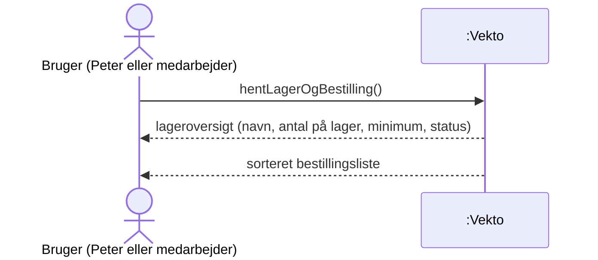
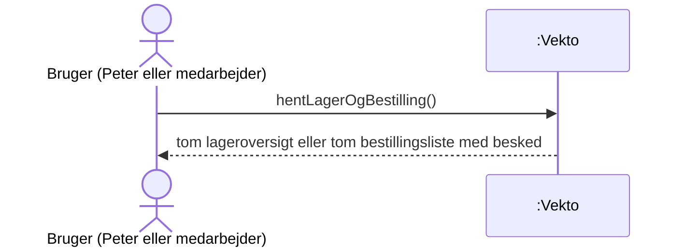

# SSD – UC7 Lager og bestilling

Systemsekvensdiagram for [UC7 Lager og bestilling](../1.%20Usecases/UC7%20Lager%20og%20bestilling.md). Systemet er en sort boks (*Vekto*).

UC7 er en ren visning: brugeren beder om overblikket, og systemet svarer. Ingen data ændres.

## Hovedscenarie

## Udvidelser

### 2a / 3a. Intet lager eller intet at bestille

## Systemoperationer

| Operation | Parametre | Svar | Kontrakt |
| :---- | :---- | :---- | :---- |
| hentLagerOgBestilling | – | Lageroversigt og bestillingsliste | – (forespørgsel, ændrer intet) |

## Noter

- Systemoperationen har ingen kontrakt, fordi den kun læser data. Systemoperationer med kontrakt findes i UC3, UC6 og UC9.
- Status *skal bestilles* afgøres af reglen: antal på lager er **på eller under** minimum.
- Sorteringen af bestillingslisten er ikke fastlagt. \[Antagelse\]
