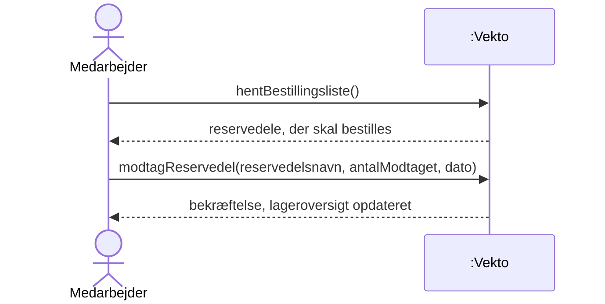
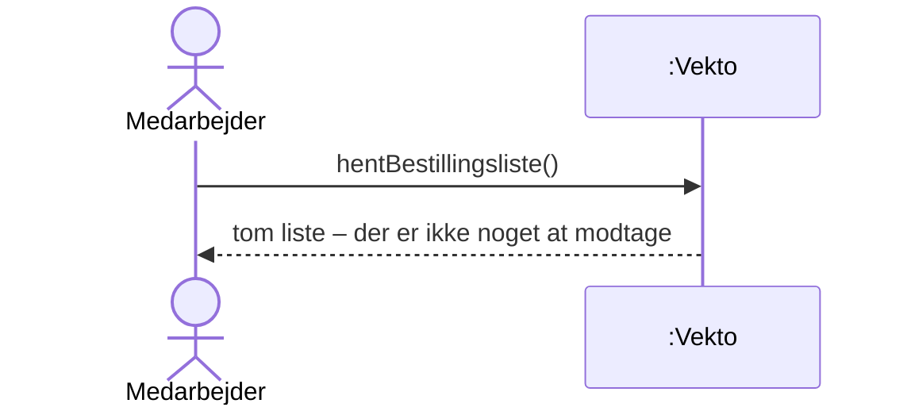
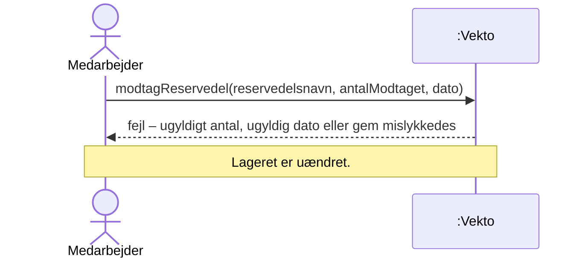

# SSD – UC9 Opret Reservedele Modtagelse

Systemsekvensdiagram for [UC9 Opret Reservedele Modtagelse](../1.%20Usecases/UC9%20Opret%20Reservedele%20Modtagelse.md). Systemet er en sort boks (*Vekto*).

## Hovedscenarie

## Udvidelser

### 2a. Bestillingslisten er tom

### 4a / 5a / 7a. Ugyldigt antal, ugyldig dato eller gem fejler

## Systemoperationer

| Operation | Parametre | Svar | Kontrakt |
| :---- | :---- | :---- | :---- |
| hentBestillingsliste | – | Reservedele på eller under minimum | – (forespørgsel, ændrer intet) |
| modtagReservedel | reservedelsnavn, antalModtaget, dato | Bekræftelse eller fejl | [SOK](../5.%20System%20Operations%20Kontrakt/SOK%20UC9%20Opret%20Reservedele%20Modtagelse.md) |

## Noter

- Formularen viser kun reservedele fra bestillingslisten (UC9 trin 3), derfor hentes listen først. Den samme liste bruges i [UC7](../1.%20Usecases/UC7%20Lager%20og%20bestilling.md).
- Dagens dato kan være forudfyldt, men sendes med som parameter. \[Antagelse\]
