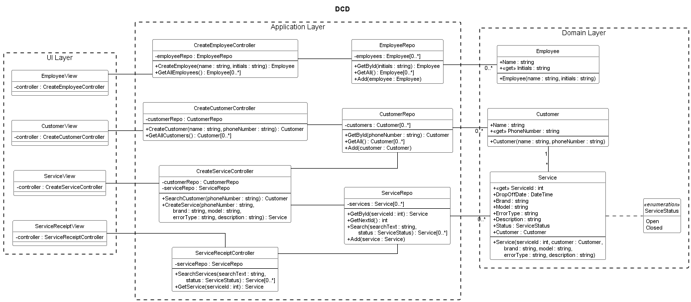

# Designklassediagram (DCD) – Vekto værkstedssystem

> **Status:** Diagrammet er opdateret ud fra WPF-programmet i [12. Vekto WPF Application](../12.%20Vekto%20WPF%20Application/Vekto/). Det dækker alle sider undtagen Service oversigt: **Hovedvindue**, **Opret medarbejder (UC1)**, **Opret kunde (UC2)**, **Opret service (UC3)** og dialogen **Service kvittering (UC4)**. Service oversigt (UC5) og UC6–UC9 er ikke med.

- [designklassediagram.puml](designklassediagram.puml) er kilden i PlantUML.
- [designklassediagram.png](designklassediagram.png) er billedet til rapporten, lavet ud fra `.puml`-filen.

Layoutet ligger fast i `.puml`-filen med `left to right direction` og `linetype ortho`. Lagene står fra venstre mod højre (View → Controller → Repository → domæneklasse) i stiplede rammer som i Disaheim-eksemplet. Renderes med Graphviz (standard i PlantUML-udvidelsen til VS Code).

DCD'et passer sammen med [sekvensdiagrammerne](../6.%20Sekvens%20Diagrammer/) for UC1–UC4, som også er opdateret ud fra programmet.

## Opbygning

| Lag | Klasser | Ansvar |
| :---- | :---- | :---- |
| **UI Layer** | MainWindow, CreateEmployee, CreateCostumer, CreateService, CreateReceipt | WPF-siderne (`Views`). MainWindow har menuen og viser den valgte side i `PageArea`. Hver side opretter sin egen controller (`- controller : …`). CreateService åbner dialogen CreateReceipt, når servicen er oprettet. |
| **Application Layer** | En **use case controller** pr. side: CreateEmployeeController, CreateCostumerController, CreateServiceController, CreateReceiptController. Et **repository** pr. domæneklasse: EmployeeRepository, CostumerRepository, ServiceRepository. | Controlleren modtager kaldene fra siden og delegerer (GRASP Controller). Repositoriet opbevarer objekterne i en privat liste og gemmer dem i en csv-fil (Repository-mønstret, SRP). |
| **Domain Layer** | Employee, Costumer, Service, ServiceStatus | Domæneklasserne (`Models`). |

## Notation (som i undervisningens eksempler)

- **Lag:** UI Layer, Application Layer og Domain Layer står hver i en stiplet ramme, ligesom i Disaheim-eksemplet (Pr19).
- **Synlighed:** `+` public, `-` private.
- **Properties og felter:** `+ Name : string` er en property, og `- employees : Employee[0..*]` er et privat felt (Pr16).
- **`«get»`** er en property, der kun kan læses. Den bruges til listerne på controllerne (`Employees`, `Costumers`, `ErrorTypes`), som siderne binder til.
- **Constructors** står med klassens navn, fx `+ Employee(name : string, initials : string)`. Controllernes og repositoriernes constructors er med, fordi de gør noget: controlleren opretter sine repositories, og repositoriet læser csv-filen.
- **Event handlers** på siderne står uden parametre, fx `- btnCreate_Click()`. I koden har de `(sender : object, e : RoutedEventArgs)`.
- **Kun brugte metoder:** Der er kun taget de metoder med, som siderne bruger (og som står i SD'erne).
- **Linjer:**
  - MainWindow — side, side — controller — repository er tegnet uden pile som i Disaheim.
  - Repository — domæneklasse har `0..*` i domæneenden.
  - Service — Costumer og Service — Employee har multiplicitet i begge ender. Noten på linjen viser, hvilken nøgle Service gemmer.
  - Enum'en er forbundet med en stiplet linje.

## Fra domænemodel til designklasse

| Domænemodel | DCD | Nøgle (`Get`) |
| :---- | :---- | :---- |
| Medarbejder (navn, initialer) | Employee (Name, Initials) | Initials. De skal være unikke (CO1). |
| Kunde (navn, telefonnummer) | Costumer (Name, PhoneNumber) | PhoneNumber. Kunden søges på telefonnummer (UC2, UC3). |
| Reparation (reparationsnummer, indleveringsdato, mærke, model, fejltype, fejlbeskrivelse, status, udført arbejde) | Service (ServiceId, DropOffDate, Brand, Model, ErrorType, Description, Status, Customer, CompletedWork, Employee, ClosedDate) | ServiceId. Det næste nummer hentes med `GetNextId()` og starter ved 1001. |
| status (Åben/Lukket) | ServiceStatus (Open, Closed) | – |
| Kunde 1 – \* Reparation | Costumer 1 – \* Service | Service.Customer = Costumer.PhoneNumber |
| Medarbejder 0..1 – \* Reparation | Employee 0..1 – \* Service | Service.Employee = Employee.Initials |

Service gemmer kun kundens telefonnummer og medarbejderens initialer (som `string`), fordi alt gemmes i csv-filer. Derfor slår CreateReceiptController kunden og medarbejderen op med `GetCostumer` og `GetEmployee`. `CompletedWork`, `Employee` og `ClosedDate` udfyldes først, når servicen lukkes på Service oversigt. Kvitteringen viser dem kun, når servicen er lukket.

## Sporbarhed: side → SD → DCD

| UC | Side og hændelse | Controller-operation | Repository- og domæneoperationer i SD'et |
| :---- | :---- | :---- | :---- |
| – | MainWindow: menuknap | – | `«create»` af siden, som vises i `PageArea` |
| UC1 | CreateEmployee: åbn siden | `CreateEmployeeController()`, `Employees` | `«create» EmployeeRepository` → `Load()`, `GetAll()` |
| UC1 | CreateEmployee: `btnCreate_Click` | `CreateEmployee(name, initials)` | `Get(initials)`, `«create» Employee(name, initials)`, `Add(employee)` → `Save()` |
| UC2 | CreateCostumer: åbn siden | `CreateCostumerController()`, `Costumers` | `«create» CostumerRepository` → `Load()`, `GetAll()` |
| UC2 | CreateCostumer: `btnCreate_Click` | `CreateCostumer(name, phoneNumber)` | `Get(phoneNumber)`, `«create» Costumer(name, phoneNumber)`, `Add(costumer)` → `Save()` |
| UC3 | CreateService: åbn siden | `CreateServiceController()`, `ErrorTypes` | `«create» CostumerRepository` og `ServiceRepository` |
| UC3 | CreateService: `tbPhone_TextChanged` | `SearchCustomer(phoneNumber)` | `CostumerRepository.Get(phoneNumber)` |
| UC3 | CreateService: `btnCreate_Click` | `CreateService(phoneNumber, brand, model, errorType, description)` | `SearchCustomer`, `ServiceRepository.GetNextId()`, `ServiceRepository.Add(...)` → `«create» Service(...)` og `Save()`. Åbner derefter CreateReceipt. |
| UC4 | CreateReceipt: `ShowService(serviceId)` | `GetService(serviceId)`, `GetCostumer(phoneNumber)`, `GetEmployee(initials)` | `ServiceRepository.Get`, `CostumerRepository.Get`, `EmployeeRepository.Get` |
| UC4 | CreateReceipt: `btnClose_Click` | – | `DialogResult = true` lukker dialogen |

## Ændringer i forhold til den forrige version

| Før | Nu (som i koden) |
| :---- | :---- |
| `EmployeeView`, `CustomerView`, `ServiceView`, `ServiceReceiptView` | `CreateEmployee`, `CreateCostumer`, `CreateService`, `CreateReceipt`. `MainWindow` er kommet med. |
| `Customer`, `CustomerRepo`, `CreateCustomerController` | `Costumer`, `CostumerRepository`, `CreateCostumerController` |
| `...Repo` med `GetById` | `...Repository` med `Get`. Repositorierne har også `fileName`, `Load()`/`InitializeRepository()` og `Save()` til csv-filen. |
| `GetAllEmployees()` og `GetAllCustomers()` på controllerne | Controllerens constructor henter listen med `GetAll()` og lægger den i `«get» Employees` / `Costumers`, som siden binder til. |
| `ServiceReceiptController` med `SearchServices` | `CreateReceiptController` med `GetService`, `GetCostumer` og `GetEmployee`. Kvitteringen åbnes med et servicenummer, så der søges ikke. |
| Controlleren opretter Service og kalder `Add(service)` | `ServiceRepository.Add(...)` får værdierne og opretter selv Service (Creator). |
| `Service.Customer : Customer` | `Service.Customer : string` (telefonnummeret). Nye felter: `CompletedWork`, `Employee` og `ClosedDate`. |
| `«get»` på `Initials`, `PhoneNumber` og `ServiceId` | Almindelige properties, fordi de har `set` i koden. |

## Ikke med i diagrammet

- **Service oversigt (UC5):** `ServiceOverview`, `ServiceOverviewController`, `ServiceRow` og `ServiceRepository.RegisterCompletedWork`.
- **Metoder, som ingen af siderne kalder:** `CreateReceiptController.SearchServices`, `ServiceRepository.GetAll`, `Update` og `Remove`.
- **Tomme klasser:** `MainViewModel` og `App`.

## Valg, hvor pensum ikke er entydigt

- **Én controller pr. use case.** Vi følger eksemplet med `BookMeetingController` (use case controller).
- **MVVM.** Projektet er WPF. Controllerne har den rolle, som ViewModel har i MVVM (Pr26): de formidler mellem View og Model og kender ikke View. Siderne binder til controllerens lister via `DataContext`.
- **Felt og linje.** Larman siger, at en anden klasse vises som en linje og ikke som attributtekst. Undervisningens eksempler viser begge dele, fx `- bookRepo : BookRepository` sammen med en linje. Vi følger eksemplerne.
- **Pile.** Larman bruger navigationspile, men undervisningens eksempler bruger linjer uden pile. Vi følger eksemplerne.

## Punkter at rette i andre artefakter

1. **SSD'erne for UC1 og UC2** returnerer `medarbejderId` og `kundeId`. I designet er id'et initialerne og telefonnummeret. Skriv det i SSD'erne eller i ordlisten.
2. **Kontrakten CO3** nævner Reparationsordre, ordrenummer og en Cykel-instans. Ret den til Service/Reparation med mærke og model som attributter, som i domænemodellen.
3. **Stavning i koden:** Klasserne hedder `Costumer` og ikke `Customer`. DCD'et følger koden. Retter I navnet i koden, skal DCD'et og SD'erne rettes med.
