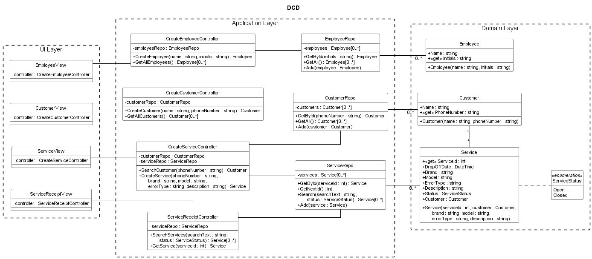

# Designklassediagram (DCD) – Vekto værkstedssystem

> **Status:** Diagrammet dækker indtil videre **UC1–UC4** (Opret Medarbejder, Opret Kunde, Opret Service og Service Kvittering). UC5–UC9 tilføjes bagefter i samme stil.

- [designklassediagram.puml](designklassediagram.puml) er kilden i PlantUML.
- [designklassediagram.png](designklassediagram.png) er billedet til rapporten, lavet ud fra `.puml`-filen.

Layoutet ligger fast i `.puml`-filen med `left to right direction` og `linetype ortho`. Lagene står fra venstre mod højre (View → Controller → Repo → domæneklasse) i stiplede rammer som i Disaheim-eksemplet. Renderes med Graphviz (standard i PlantUML-udvidelsen til VS Code).

DCD'et er tegnet i samme stil som undervisningens lagdelte DCD'er: mødebookingsystemet (Pr20, `BookMeetingController` og `RoomRepo`) og Disaheim (Pr19, `Menu → Controller → BookRepository → Book`). Det bygger på [domænemodellen](../2.%20Domæne%20Model/domænemodel.md) og [sekvensdiagrammerne](../6.%20Sekvens%20Diagrammer/) for UC1–UC4.

## Opbygning

| Lag | Klasser | Ansvar |
| :---- | :---- | :---- |
| **UI Layer** | EmployeeView, CustomerView, ServiceView, ServiceReceiptView | WPF-siderne. Hvert view kender sin controller (`- controller : …`), ligesom `Menu` i Disaheim. |
| **Application Layer** | En **use case controller** pr. use case: CreateEmployeeController, CreateCustomerController, CreateServiceController, ServiceReceiptController. Et **repository** pr. domæneklasse: EmployeeRepo, CustomerRepo, ServiceRepo. | Controlleren modtager systemoperationerne fra SSD'et og delegerer (GRASP Controller). Repositoriet opbevarer objekterne i en privat liste (Repository-mønstret, SRP). |
| **Domain Layer** | Employee, Customer, Service, ServiceStatus | Domæneklasserne fra domænemodellen på engelsk med datatyper. |

## Notation (som i undervisningens eksempler)

- **Lag:** UI Layer, Application Layer og Domain Layer står hver i en stiplet ramme, ligesom i Disaheim-eksemplet (Pr19).
- **Synlighed:** `+` public, `-` private.
- **Properties og felter:** `+ Name : string` er en property, og `- employees : Employee[0..*]` er et privat felt (Pr16).
- **`«get»`** er en property, der kun kan læses, og bruges til den værdi, der identificerer objektet. Det svarer til `+ «get» Name : string` på Guest og Company i eksemplet.
- **Constructors** står med klassens navn, fx `+ Employee(name : string, initials : string)`. De kommer fra `«create»`-beskederne i SD'erne.
- **Repositories** har standardmetoderne fra eksemplet: `GetById`, `GetAll` og `Add(objekt)`. Der er kun taget de metoder med, som SD'erne bruger.
- **Linjer:**
  - View — Controller — Repo er tegnet som i Disaheim.
  - Repo — domæneklasse har `0..*` i domæneenden.
  - Service — Customer har multiplicitet i begge ender som i domænemodellen (`*` og `1`).
  - Enum'en er forbundet med en stiplet linje.

## Fra domænemodel til designklasse

| Domænemodel | DCD | Nøgle (`GetById`) |
| :---- | :---- | :---- |
| Medarbejder (navn, initialer) | Employee (Name, Initials) | Initials. De skal være unikke (CO1). |
| Kunde (navn, telefonnummer) | Customer (Name, PhoneNumber) | PhoneNumber. Kunden søges på telefonnummer (UC2, UC3). |
| Reparation (reparationsnummer, indleveringsdato, mærke, model, fejltype, fejlbeskrivelse, status) | Service (ServiceId, DropOffDate, Brand, Model, ErrorType, Description, Status, Customer) | ServiceId. Det næste nummer hentes med `GetNextId()`. |
| status (Åben/Lukket) | ServiceStatus (Open, Closed) | – |
| Kunde 1 – \* Reparation | Customer 1 – \* Service | – |

`DropOffDate` sættes til dags dato og `Status` til Open i Service-constructoren. Udført arbejde, medarbejderen på reparationen og reservedelene kommer med, når UC5 og UC6 tilføjes.

## Sporbarhed: SSD → SD → DCD

Hver systemoperation fra SSD'et har sin egen del af sekvensdiagrammet (adskilt med `== … ==`). Hver besked i SD'et er en operation i modtagerens klasse.

| UC | Systemoperation (SSD) | Controller-operation | Repo- og domæneoperationer i SD'et |
| :---- | :---- | :---- | :---- |
| UC1 | opretMedarbejder(navn, initialer) | `CreateEmployeeController.CreateEmployee` | `EmployeeRepo.GetById(initials)`, `«create» Employee(name, initials)`, `EmployeeRepo.Add(employee)` |
| UC1 | (medarbejderliste) | `CreateEmployeeController.GetAllEmployees` | `EmployeeRepo.GetAll()` |
| UC2 | opretKunde(navn, tlfNr) | `CreateCustomerController.CreateCustomer` | `CustomerRepo.GetById(phoneNumber)`, `«create» Customer(name, phoneNumber)`, `CustomerRepo.Add(customer)` |
| UC2 | (kundeliste) | `CreateCustomerController.GetAllCustomers` | `CustomerRepo.GetAll()` |
| UC3 | soegKunde(tlfNr) | `CreateServiceController.SearchCustomer` | `CustomerRepo.GetById(phoneNumber)` |
| UC3 | opretService(tlfNr, mærke, model, fejltype, fejlbeskrivelse) | `CreateServiceController.CreateService` | `CustomerRepo.GetById`, `ServiceRepo.GetNextId()`, `«create» Service(...)`, `ServiceRepo.Add(service)` |
| UC4 | soegServices(søgetekst, status) | `ServiceReceiptController.SearchServices` | `ServiceRepo.Search(searchText, status)` |
| UC4 | visKvittering(serviceId) | `ServiceReceiptController.GetService` | `ServiceRepo.GetById(serviceId)` |

## Valg, hvor pensum ikke er entydigt

- **Én controller pr. use case.** Vi følger eksemplet med `BookMeetingController` (use case controller). Pr17 tillader også én controller til flere use cases. Det kan blive aktuelt for Service, når UC5 kommer med.
- **MVVM.** Projektet er WPF. Controllerne har den rolle, som ViewModel har i MVVM (Pr26): de formidler mellem View og Model og kender ikke View.
- **Felt og linje.** Larman siger, at en anden klasse vises som en linje og ikke som attributtekst. Undervisningens eksempler viser begge dele, fx `- bookRepo : BookRepository` sammen med en linje. Vi følger eksemplerne.
- **Pile.** Larman bruger navigationspile, men undervisningens eksempler bruger linjer uden pile. Vi følger eksemplerne.

## Punkter at rette i andre artefakter

1. **SSD'erne for UC1 og UC2** returnerer `medarbejderId` og `kundeId`. I designet er id'et initialerne og telefonnummeret. Skriv det i SSD'erne eller i ordlisten.
2. **Kontrakten CO3** nævner Reparationsordre, ordrenummer og en Cykel-instans. Ret den til Service/Reparation med mærke og model som attributter, som i domænemodellen.
3. **Domænemodellen** kalder associationsklassen `Reservedelsforbrug` i `domænemodel.puml` og `Udtag` i `domænemodel.md`. Vælg ét navn, før UC6 kommer med i DCD'et.
